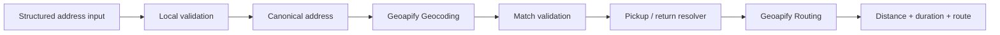
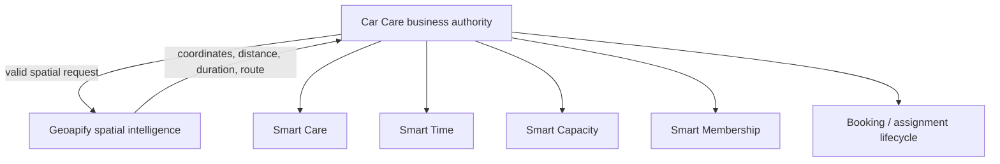

# Car Care Geo

**Open geospatial reference implementation for intelligent vehicle-care mobility using Geoapify.**

Car Care Geo demonstrates a clean boundary between vehicle-care business logic and geospatial intelligence.

> **Geoapify solves the spatial problem. The Car Care platform remains the business authority.**

This repository is a public, sanitized reference implementation derived from the private Car Care Sverige production platform.

## Why this project exists

Mobile vehicle care combines several different problems:

- structured pickup and return addresses
- address quality and ambiguity
- geographic coordinates
- route feasibility
- travel distance and duration
- booking and driver operations

These concerns should not all belong to the same system.

Car Care Geo isolates the geospatial layer so it can be tested, reviewed and reproduced independently.

## Public scope

The public repository demonstrates:

- structured Swedish address handling
- local address validation
- canonical address generation
- Geoapify geocoding
- strict geocoding-result validation
- coordinate validation
- pickup and return resolution
- same-address pickup/return handling
- Geoapify driving routing
- automated regression tests
- reproducible CI verification

The private production application, customer data, production credentials, booking records and proprietary business services are intentionally excluded.

## Architecture



## Authority boundary



The business layer decides what is allowed, required or assigned.

Geoapify determines spatial facts such as location, distance, duration and route.

Geoapify does not own booking, payment, membership, workshop-capacity or driver-assignment authority.

## Geoapify usage

### Geocoding

Structured address fields are normalized into a canonical query before geocoding.

Returned Geoapify candidates are validated before coordinates are accepted. This avoids silently treating an unrelated result as a valid customer location.

### Routing

Validated coordinates are used to resolve driving routes between pickup, service and return locations.

The routing layer provides spatial facts that higher-level systems can consume without transferring business authority to the geospatial provider.

## Smart Dispatch demonstration

The screenshot below shows the sanitized Smart Dispatch flow used in the Car Care platform. Geoapify Route Matrix provides spatial evidence such as route ETA and distance for an available driver, while the final assignment remains an explicit Car Care application action.


*Sanitized demonstration data: Geoapify ranks an available driver by ETA and distance; Car Care retains final assignment authority.*

## Production context

The private Car Care Sverige platform contains a broader mobility architecture including:

- Smart Care
- Smart Time
- Smart Capacity
- Smart Membership
- booking lifecycle
- driver dispatch
- live driver tracking
- route-corridor and deviation handling

This repository exposes only the sanitized geospatial reference boundary required to reproduce and understand the Geoapify integration.

## Repository structure

```text
car-care-geo/
├── .github/
│   └── workflows/
│       └── ci.yml
├── docs/
│   ├── ai-workflow.md
│   ├── architecture.md
│   ├── geoapify-feedback.md
│   ├── images/
│   │   └── smart-dispatch-recommendation-demo.png
│   └── tutorial.md
├── src/
│   ├── address/
│   ├── demo/
│   ├── geocoding/
│   └── routing/
├── tests/
├── .env.example
├── LICENSE
├── package.json
├── package-lock.json
├── tsconfig.json
└── vitest.config.ts
```

## Requirements

- Node.js `^22.12.0`, `^24.0.0`, or `>=26.0.0`
- npm
- a Geoapify API key for live Geoapify integration work

The automated tests and TypeScript build do not require production credentials.

## Setup

Clone the repository:

```bash
git clone https://github.com/MudherAhmad/car-care-geo.git
cd car-care-geo
```

Install the locked dependency graph:

```bash
npm ci
```

Create a local environment file:

```bash
cp .env.example .env
```

Add your own Geoapify API key:

```text
GEOAPIFY_API_KEY=your_own_geoapify_key
```

Never commit `.env`.

## Verify the project

Run the automated tests:

```bash
npm test
```

Expected reference result:

```text
Test Files  5 passed (5)
Tests       8 passed (8)
```

Build the TypeScript project:

```bash
npm run build
```

Run the dependency audit:

```bash
npm audit --audit-level=moderate
```

Complete reproducibility check:

```bash
npm ci
npm test
npm run build
npm audit --audit-level=moderate
```

## Continuous integration

Every push and pull request to `main` is verified with GitHub Actions.

The matrix currently verifies:

- Node.js 22.x
- Node.js 24.x
- Ubuntu 24.04

The workflow runs:

1. `npm ci`
2. `npm test`
3. `npm run build`
4. `npm audit --audit-level=moderate`

Third-party GitHub Actions are pinned to exact commit SHAs for better supply-chain reproducibility.

## Testing strategy

The public tests cover:

- Swedish address behavior
- strict Geoapify matching
- pickup/return resolution
- Geoapify routing behavior
- booking-route resolution

Vitest is configured to execute source tests only. Compiled tests under `dist/` are excluded to prevent duplicate execution after a build.

## Security and privacy

The repository must never contain:

- production API keys
- production credentials
- real customer information
- private production source code
- production database data
- private-key material

`.env` is ignored by Git.

Release verification also checks that the real production Geoapify key is not present in the public tree or Git history without printing the secret itself.

## AI boundary

AI can assist with interpretation, explanation and spatial exploration.

AI is not the production authority for booking mutation, membership entitlement, workshop capacity or driver assignment.

The governing rule remains:

> **Geoapify solves the spatial problem. The Car Care platform remains the business authority.**

## Documentation

Additional documentation lives under `docs/`:

- `docs/architecture.md` — detailed architecture
- `docs/tutorial.md` — public walkthrough
- `docs/ai-workflow.md` — AI workflow and prompt documentation
- `docs/geoapify-feedback.md` — Geoapify integration feedback and lessons learned

These are expanded separately from the main README.

## Reproducibility

The repository uses:

- committed `package-lock.json`
- deterministic `npm ci`
- explicit Node.js compatibility
- isolated Vitest configuration
- pinned GitHub Actions
- fixed Ubuntu CI runner
- automated test, build and audit gates

A fresh public clone can be validated without access to the private production repository.

## License

MIT License.

See `LICENSE` for the complete license text.

Copyright (c) 2026 Mudher Ahmad.
