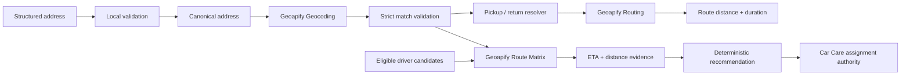

# Architecture

Car Care Geo is a sanitized public reference derived from the broader private Car Care Sverige platform.

> **Geoapify solves the spatial problem. The Car Care platform remains the business authority.**

## Public geospatial flow

1. Structured address input
2. Local validation
3. Canonical address generation
4. Geoapify Geocoding
5. Strict result and coordinate validation
6. Pickup/return resolution
7. Geoapify Routing
8. Booking-level distance and duration
9. Application-approved driver candidates
10. Geoapify Route Matrix
11. Deterministic ranking by driving ETA, then distance
12. Spatial recommendation returned without assignment mutation

## Authority boundary

Geoapify determines spatial facts:

- validated geographic coordinates
- road distance
- driving ETA
- route feasibility
- Route Matrix evidence

Car Care remains responsible for:

- driver eligibility and availability
- booking conflicts
- location-freshness policy
- booking state
- permissions
- final driver assignment

Route Matrix receives only candidates already considered eligible by the surrounding application.

The public ranking preserves the production priorities: lowest ETA first, then lowest distance. A stable identifier is used only as a final deterministic tie-breaker in this public reference.

An unreachable matrix cell remains unavailable spatial evidence. No route, ETA or distance is invented.

If Route Matrix is unavailable, the recommendation degrades safely and no driver is recommended from missing spatial evidence.

## Private production boundary

The private production repository is not part of this repository.

Production customer data, credentials, database access, booking records and proprietary application services are intentionally excluded.

The public repository reproduces only the sanitized geospatial boundary needed to understand, test and review the Geoapify integration.
