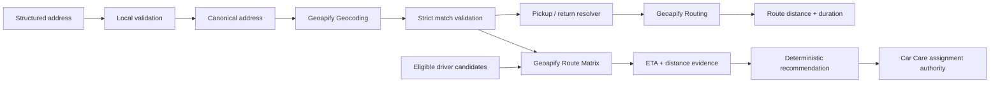

# Architecture

Car Care Geo is a sanitized public reference derived from the broader private Car Care Sverige platform.

> **Geoapify solves the spatial problem. The Car Care platform remains the business authority.**

## Public geospatial flow

1. Structured address input
2. Local validation
3. Canonical address generation
4. Geoapify Geocoding
5. Strict result and coordinate validation
6. Pickup/return resolution
7. Geoapify Routing
8. Booking-level distance and duration
9. Application-approved driver candidates
10. Geoapify Route Matrix
11. Deterministic ranking by driving ETA, then distance
12. Spatial recommendation returned without assignment mutation

## Authority boundary

Geoapify determines spatial facts:

- validated geographic coordinates
- road distance
- driving ETA
- route feasibility
- Route Matrix evidence

Car Care remains responsible for:

- driver eligibility and availability
- booking conflicts
- location-freshness policy
- booking state
- permissions
- final driver assignment

Route Matrix receives only candidates already considered eligible by the surrounding application.

The public ranking preserves the production priorities: lowest ETA first, then lowest distance. A stable identifier is used only as a final deterministic tie-breaker in this public reference.

An unreachable matrix cell remains unavailable spatial evidence. No route, ETA or distance is invented.

If Route Matrix is unavailable, the recommendation degrades safely and no driver is recommended from missing spatial evidence.

## Private production boundary

The private production repository is not part of this repository.

Production customer data, credentials, database access, booking records and proprietary application services are intentionally excluded.

The public repository reproduces only the sanitized geospatial boundary needed to understand, test and review the Geoapify integration.

## Booking address entry and verification — November 2026

The private booking improvement adds an entry-stage flow before the existing geospatial and business-authority boundaries:

- Context-aware Geoapify autocomplete is requested through the application backend with Sweden-restricted results. Credentials remain server-side; the client receives only the suggestion components needed for entry.
- Debouncing and request revisions prevent older suggestions from replacing results for newer input or changed structured context. Selecting a suggestion populates provider-returned fields without inventing an address.
- Complete pickup and, where different, return addresses are verified before checkout. Same-return reuse is tied to current pickup verification. Edits invalidate that verification, and late responses cannot authorize progression.
- Swedish errors, loading, empty-result and temporary-failure states remain inline. Optional apartment or floor information stays outside geocoding components.
- Prevalidation produces address evidence without creating a booking or changing payment, membership, capacity or assignment state. Final server-side validation remains required at booking creation.

A suggested postal code may exist while still being incompatible with the rest of the address. Autocomplete and whole-address acceptance therefore remain separate contracts. Provider unavailability is also distinct from an address mismatch.

This is documentation of the private application's improvement, not a claim that its application code or customer data is included in the public reference.

## Nexus future integration boundary

A future Nexus integration could consume sanitized, application-approved spatial summaries to explain address problems, route distance or ETA. No direct Geoapify-to-Nexus production integration is asserted here.

Nexus or another AI interface must not infer business permission from spatial evidence. Existing deterministic services retain authorization, booking, payment, membership, time, capacity and driver-assignment authority. Any future action interface requires its own reviewed permissions and validation; autocomplete or an AI explanation cannot bypass those controls.
